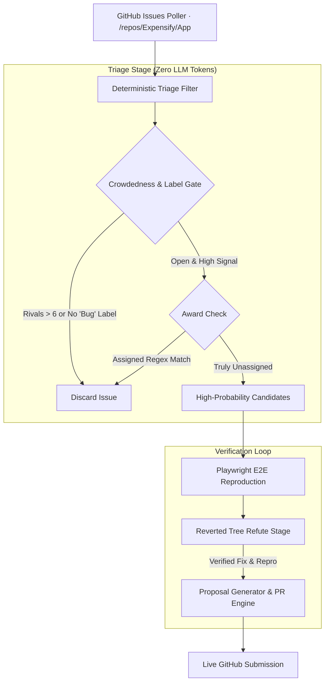

# Expensify Bounty Sniper

> Automated bug bounty intelligence and issue-sniping loop for competitive open-source repositories. Built for Expensify/App ($250–$1,000 bounties).

## 🎯 The Problem

In high-volume open-source bug bounties (like Expensify's Help Wanted queue), winning is a function of targeting and verification:
- **Obvious bugs:** Crowded with 10+ identical proposals within minutes. High risk of duplication and zero-payout ProposalPolice rejections.
- **Complex bugs:** Long-open, multi-file regressions where verification pays off, but manual reproduction on a local clone takes 30–60 minutes.
- **The "Taken" Signal trap:** Melvin bot leaves multiple near-twin comments (`Job added to Upwork`, `we don't have your contributor details yet`). Naive scrapers mistake these for assignments and discard 70%+ of winnable open bounties.

## 🏛️ System Architecture

## 🔬 Key Engineering Insights

- **The Single Truth of Assignment:** On Expensify, exactly one message confirms assignment: `📣 @user You have been assigned to this job!`. Proposer detail requests (`we don't have your details...`) are mere noise. Correctly distinguishing this restored 23 discarded bounties in a single 75-issue sweep.
- **Playwright Strict-Mode Defenses:** Resolving menu ambiguous selectors via unique test IDs (`FABMenu-CreateExpense` rather than text labels) and handling visibility-race timeouts during dynamic React DOM mounts.
- **Refutation on Reverted Tree:** Verifying fixes against a freshly reverted branch to guarantee the claim judges against shipping code rather than diff self-persuasion.
